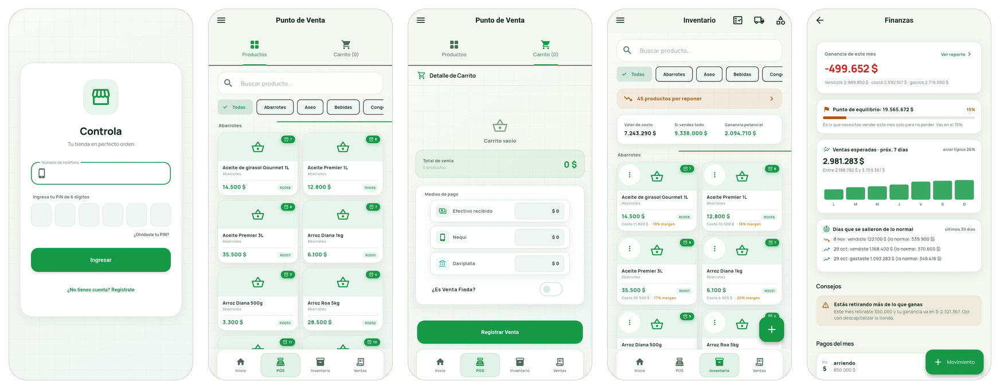
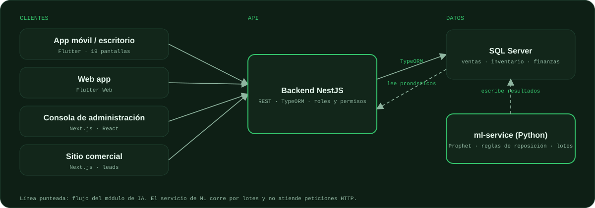

<picture><source media="(prefers-color-scheme: dark)" srcset="assets/hero-dark.svg"><source media="(prefers-color-scheme: light)" srcset="assets/hero-light.svg"></picture>

> **Repositorio de presentación.** El código de Controla es privado porque hace parte de mi proyecto de grado y de un producto en desarrollo. Aquí documento el problema, la arquitectura, las decisiones técnicas y cómo lo validé. Si quieres ver una demo o conversar sobre el código, escríbeme.

## El problema

Las tiendas de barrio en Colombia manejan ventas, fiado, inventario y caja entre cuaderno, calculadora y WhatsApp. No saben con claridad cuánto ganan, qué producto se les está agotando ni quién les debe. Controla reúne eso en una sola herramienta pensada para el dueño y sus empleados, con los medios de pago que realmente usan: efectivo, Nequi, Daviplata y fiado.

Acceso · Punto de venta · Medios de pago · Inventario · Finanzas con pronóstico de ventas. Capturas de la app con datos de un negocio de prueba.

## Qué hace

| Área | Funcionalidad |
| :-- | :-- |
| **Punto de venta** | Ventas con efectivo y vuelto, Nequi, Daviplata, fiado y pagos mixtos. Productos por unidad, por peso y con tallas. |
| **Inventario** | Stock, proveedores y pedidos de compra, conteo de inventario y alertas de stock bajo. |
| **Finanzas** | Utilidad, gastos fijos prorrateados por periodo, retiros y cierre de caja con reconciliación. |
| **Clientes** | Fiado, abonos y seguimiento de deudas. |
| **Equipo** | Dueño y empleados con permisos aplicados en el backend. Multi-negocio. |
| **Offline** | Cola de sincronización para vender sin conexión. |
| **Inteligencia** | Pronóstico de flujo de caja a 30 días y sugerencias de reposición. |
| **Administración** | Consola web con actividad por negocio, facturación y monitoreo de errores. |

## Arquitectura

<picture><source media="(prefers-color-scheme: dark)" srcset="assets/architecture-dark.svg"><source media="(prefers-color-scheme: light)" srcset="assets/architecture-light.svg"></picture>

- **App** en Flutter (móvil y escritorio, 19 pantallas) y versión web.
- **Backend** en NestJS con TypeORM y migraciones formales, validación de entrada con DTOs y aislamiento entre negocios (multi-tenant) verificado con pruebas.
- **Base de datos** SQL Server. Empecé en PostgreSQL y migré el motor a mitad del proyecto.
- **Módulo de IA** en Python, separado del backend y ejecutado por lotes: escribe sus resultados en la misma base y el backend solo los lee.
- **Frontends web** en Next.js: consola de administración y sitio comercial con captura de leads.
- **Despliegue** con Docker, HTTPS automático con Caddy y CI/CD que publica el backend en cada cambio relevante.

## Decisiones que quiero destacar

- **Una predicción mala es peor que ninguna.** Antes de publicar un pronóstico, el servicio de ML hace *backtesting* con los últimos 14 días y calcula el error (MAPE). Si supera el umbral, no publica nada.
- **Reglas primero, modelos después.** La reposición usa reglas y estadística simple, que se explican al tendero. Prophet se reserva para donde hay historial suficiente.
- **El dinero se valida en el servidor.** Cantidades, montos y estados se validan en el backend, no solo en la app.

## Cómo lo validé

Hice una prueba de punta a punta sobre el sistema en producción, simulando 5 tipos de negocio (ropa, papelería, mercado, entre otros) con agentes de IA que recorrían los flujos reales de un tendero.

- Encontré **10 hallazgos**: validaciones de cantidades, cálculo de utilidad, sincronización de stock por peso y tallas, alertas ruidosas y sesgos del modelo de ML.
- **9 quedaron corregidos y verificados el mismo día.** Uno (paginación de listas) sigue pendiente.
- Tras las correcciones, el error del pronóstico en uno de los negocios de prueba bajó de **25,7 % a 14,1 %**. Esos negocios usan datos sintéticos de prueba, no ventas reales.

## Contexto académico

Proyecto de grado de Ingeniería de Sistemas, Universidad EAN. Cuenta con marco de investigación, estado del arte, metodología mixta y análisis de viabilidad financiera.

## Autor

**Nicolás Becerra** · Ingeniero de sistemas · Fundador de **bcr.**
[Perfil de GitHub](https://github.com/nicobcra) · [LinkedIn](https://www.linkedin.com/in/nicolas-felipe-becerra-jimenez-771a83263/) · [nbecerran73@gmail.com](mailto:nbecerran73@gmail.com)
